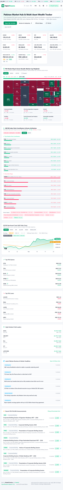
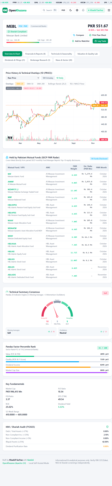
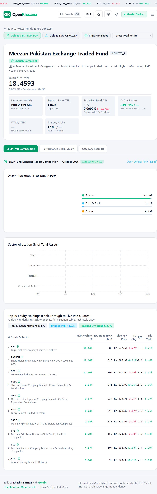
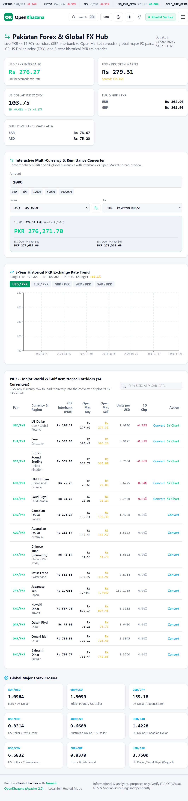
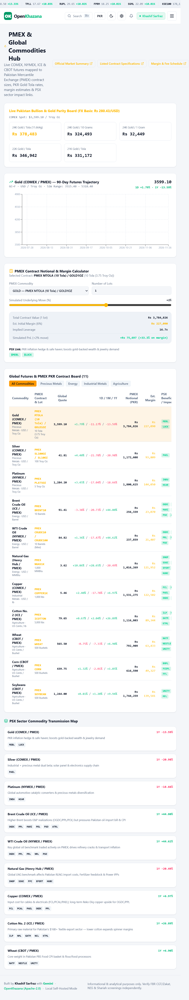
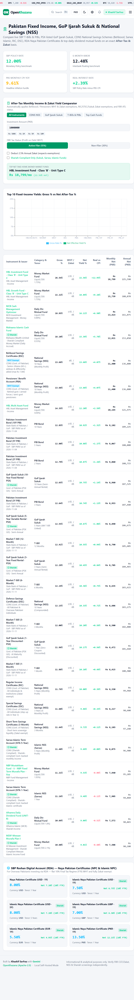
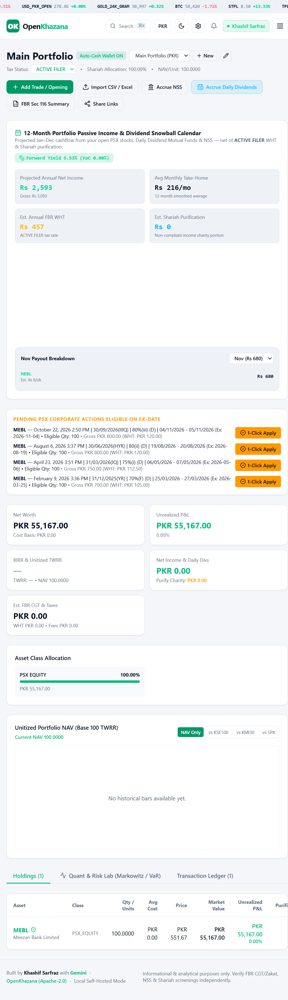
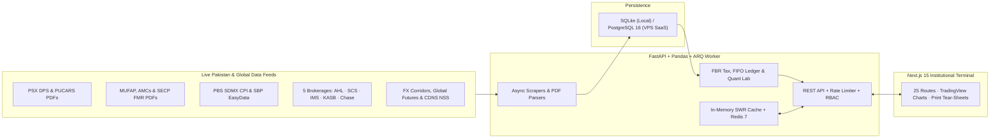

<div align="center">

# OpenKhazana

### Institutional-Grade Open-Source Pakistan Financial Market Terminal & Multi-Asset Portfolio Platform

[](https://github.com/Khashif-Finance/OpenKhazana/releases/tag/v1.0.0)
[](./LICENSE)
[](https://github.com/Khashif-Finance/OpenKhazana/actions)
[](./apps/api)
[](./apps/web)
[](./DEPLOY.md)

[Features](#-platform-capabilities) •
[Screenshots](#-screenshots) •
[Architecture](#-system-architecture) •
[Data Feeds](#-live-data-sources) •
[Quick Start](#-quick-start) •
[VPS SaaS Deploy](#-option-b--production-vps--cloud-saas-caddy-auto-https) •
[License](#-license)

</div>

---

**OpenKhazana** is a 100% open-source, self-hostable, and VPS/SaaS-ready financial terminal engineered specifically for Pakistani and global investors. It brings together live **Pakistan Stock Exchange (PSX)** equities, **KSE-100/KMI-30 index point attribution**, **5-Brokerage Equity Research**, **MUFAP & SECP Monthly Fund Manager Report (FMR) parsing**, **Daily Dividend mutual fund accrual**, **PKR ↔ 14 FCY Forex corridors**, **PMEX & Global Commodities**, **Fixed Income / GoP Ijarah Sukuk / CDNS National Savings (NSS)**, **PBS & SBP EasyData macroeconomics**, **PUCARS PDF 3-statement parsing**, **Pandas quantitative analytics**, **transparent Shariah compliance & dividend purification**, and a full **FBR Finance Act tax-ready FIFO portfolio ledger**.

Run it locally in **zero-login SQLite mode** in under a minute, or deploy it on any \$5–\$10/mo VPS in **multi-user SaaS mode** with PostgreSQL 16, Redis 7, ARQ workers, rate limiting, and automatic Let's Encrypt HTTPS via Caddy.

---

## Screenshots


### 1. Market Overview, KSE-100 Index Point Contributors & Sector Treemap (`/`)
> **[ Screenshot Placeholder — `docs/screenshots/01-market-overview.png` ]**
  

### 2. Tabbed Equity Workbench, Technical Speedometer & Pandas 3-Statement Financials (`/stocks/[symbol]`)
> **[ Screenshot Placeholder — `docs/screenshots/02-stock-workbench.png` ]**
 

### 3. 5-Brokerage Equity Research Hub — AHL, SCS, IMS, KASB & Chase (`/stocks/research`)
> **[ Screenshot Placeholder — `docs/screenshots/03-brokerage-research.png` ]**
  

### 4. Mutual Funds SECP FMR Fact Sheet, AMC Leaderboard & Holdings Overlap Lab (`/funds`)
> **[ Screenshot Placeholder — `docs/screenshots/04-mutual-funds-lab.png` ]**
  

### 5. Forex & Remittance Hub (`/markets/forex`) & PMEX Commodities (`/markets/commodities`)
| Forex & 14 PKR Corridors | PMEX & Pakistan Gold Parity Board |
|---|---|
| **[ Screenshot Placeholder — `docs/screenshots/05-forex-remittance.png` ]** | **[ Screenshot Placeholder — `docs/screenshots/06-pmex-commodities.png` ]** |
  |  

### 6. Fixed Income, GoP Ijarah Sukuk & National Savings After-Tax Comparator (`/markets/fixed-income`)
> **[ Screenshot Placeholder — `docs/screenshots/07-fixed-income-nss.png` ]**
  

### 7. Multi-Asset FBR Portfolio Ledger, 12-Month Dividend Snowball Calendar & Quant Lab (`/portfolio`)
> **[ Screenshot Placeholder — `docs/screenshots/08-portfolio-dividends.png` ]**
  

---

## Platform Capabilities

OpenKhazana is organized around a clean **5-Heading Institutional Navigation Bar** (`Markets` · `Stocks` · `Mutual Funds` · `FX & Commodities` · `Portfolio`) plus a quick **Settings & Pipeline (`⚙️`)** utility dropdown, live PSX trading-session clock, toggleable market tape, and `<1ms` local `Ctrl+K` / `⌘K` search across 870+ assets.

| Hub | Key Pages & Capabilities |
|---|---|
| **Markets** | • **Overview & Heatmap (`/`)**: Live KSE-100 / KMI-30 / KSE-30 indices, **KSE-100 & KMI-30 Index Point Contributors & Sector Attribution**, interactive market-cap Treemap heatmap, top gainers/losers/yield leaders.<br>• **Sectors & Industries (`/markets/sectors`)**: All 37 PSX sectors with Pandas medians (P/E, P/B, ROE, Div Yield), breadth, Shariah ratios & expandable stock accordions.<br>• **IPOs & Corporate Calendar (`/markets/ipos`, `/markets/calendar`)**: PSX Main & GEM Board IPOs with live Post-IPO Return % vs Strike Price, Ex-Dividend, Bonus/Rights, Board Meetings & Results calendar.<br>• **Pakistan Financial News (`/markets/news`)**: Aggregated RSS from Business Recorder, Profit (Pakistan Today), Dawn, Express Tribune & Investing.com — auto-tagged to 500+ PSX tickers & 37 sectors.<br>• **Quant & Macro Lab (`/analytics`)**: Live **PBS Monthly CPI YoY & COICOP basket**, **SBP Policy Rate vs CPI Real Interest Rate**, **SBP FX Reserves**, **Workers' Remittances**, **Current Account Balance**, SBP PKRV yield curves, multi-asset backtester (Nominal / Real USD / Real CPI), and correlation matrix. |
| **Stocks** | • **PSX & Global Directory (`/stocks`) & Technical Screener (`/screener`)**: Filter 500+ PSX & international stocks/ETFs on RSI, MACD, Supertrend, Piotroski F-Score, P/E, ROE, Dividend Yield & Shariah status.<br>• **7-Tab Equity Workbench (`/stocks/[symbol]`)**:<br>&nbsp;&nbsp;1. *Overview & Chart*: TradingView `lightweight-charts` (`PRICE`, `GROSS_TR`, `NET_FILER`, `NET_NON_FILER` + Shariah purification), 20-indicator Technical Speedometer Gauge, Pandas Factor Percentile Ranks, and **Held by Pakistani Mutual Funds (SECP FMR Radar)**.<br>&nbsp;&nbsp;2. *Financials & Reports*: Multi-period Annual & Quarterly 3-Statement Pandas analyzer (YoY growth, common-size margins, 3Y/5Y CAGRs, cash conversion, Sloan accruals, DSO/DIO) from auto-parsed & drag-and-drop PUCARS PDFs + Auditor Opinion & CSV export.<br>&nbsp;&nbsp;3. *Technicals & Seasonality*: 12 MAs + 8 Oscillators Buy/Sell table, pivots, and **Pandas Monthly Seasonality Heatmap (Year × Month)**.<br>&nbsp;&nbsp;4. *Valuation & Quality Lab*: Interactive 2-stage FCF DCF Growth/WACC sliders + 5×5 Sensitivity Matrix, 3-Factor DuPont ROE, 9-point Piotroski checklist, sector peer multiples & Bull/Bear Red-Flag digest.<br>&nbsp;&nbsp;5. *Dividends & Filings*: Multi-year dividend streak & 1-click PUCARS PDF downloads.<br>&nbsp;&nbsp;6. *Brokerage Research*: Matched company & sector equity research notes + direct desk links.<br>&nbsp;&nbsp;7. *News & Sector Coverage*: Company-specific and sector news feeds.<br>&nbsp;&nbsp;+ **1-Click Print / Save Institutional Tear-Sheet PDF** (`@media print` layout).<br>• **5-Brokerage Equity Research Hub (`/stocks/research`)**: Live reports from **Arif Habib Ltd (AHL)**, **SCS Trade**, **Intermarket Securities (IMS)**, **KASB / KTrade**, and **Chase Securities** — with Stance/Target Price extraction, stock tagging, 1-click PDF proxy downloads & per-user custom bookmarking.<br>• **Compare Stocks (`/stocks/compare`) & Filings Downloads (`/stocks/downloads`)**: 2–5 stock normalized comparison matrix & centralized PUCARS/FMR PDF download hub. |
| **Mutual Funds** | • **MUFAP & Multi-AMC Directory (`/funds`)**: 330+ open-end mutual funds & VPS pension schemes with Risk vs Return Efficiency Frontier scatter, Sharpe/Sortino/Alpha/Beta, and 5-year fee drag.<br>• **SECP Monthly FMR Fact Sheets (`/funds/[symbol]`)**: Automated & drag-and-drop PDF parsing of official AMC FMR booklets (Asset Allocation, Top-10 Equity Holdings cross-linked to live PSX prices & implied P/E, Sector Mix, Credit Quality, WAM, Stability Rating, TER + Govt Levies, Manager Commentary) + **1-Click Print Fact Sheet PDF**.<br>• **Full Live Daily Dividend Funds Engine**: Auto-accrues daily dividends (Gross & Net after 15% Filer / 30% Non-Filer WHT) for constant-NAV funds (`MRAF`, `MDIP1`, `MMMP`, `NIDDF`, `MCF`, `MICF`, `SGOV`) with an interactive Daily/Monthly/Annual DRIP simulator.<br>• **Mutual Funds Institutional Lab (`/funds?tab=lab`)**: **AMC Leaderboard & Category Champions**, **After-Tax & Fee (FEL + TER + WHT) SIP Comparator** vs CDNS NSS, and **SECP FMR Top-10 Holdings Overlap & Redundant Fee Detector**. |
| **FX & Commodities** | • **Forex & Remittance Hub (`/markets/forex`)**: Live PKR ↔ 14 FCY corridors (USD, EUR, GBP, AED, SAR, CAD, AUD, CNY, CHF, JPY, KWD, QAR, OMR, BHD) comparing SBP Interbank vs Open Market Buy/Sell spreads, interactive currency/remittance converter, 9 Global Major FX pairs + ICE `DXY`, and 5Y PKR trend charts.<br>• **PMEX & Global Commodities (`/markets/commodities`)**: Live Gold, Silver, Platinum, Brent, WTI, Natural Gas, Copper, Cotton, Wheat, Corn & Soybeans mapped to PKR, **Pakistan Gold Parity Board** (24K/22K/21K per Tola, 10g & 1g), interactive **PMEX Lot Notional & Margin Calculator**, 90D charts & clickable **PSX Sector Impact Map**.<br>• **Fixed Income, GoP Ijarah Sukuk & NSS (`/markets/fixed-income`)**: Live SBP T-Bills/PIBs, PSX GoP Ijarah Sukuk, CDNS National Savings (Behbood, Pensioners, Defence, Regular Income, Special Savings, Sarwa Islamic), SBP RDA Naya Pakistan Certificates & top money-market funds — ranked inside an **Interactive After-Tax (15%/30% WHT) & Zakat Monthly Income Comparator** (respecting Behbood/PBA exemptions). |
| **Portfolio & Tax** | • **Multi-Asset FIFO Ledger (`/portfolio`)**: Same-day intraday netting, Finance Act 2024 4-regime CGT + Section 37A 3-year loss carryforward, Section 236Z bonus tax, FBR Section 116(2) Wealth Reconciliation CSV export, Shariah dividend purification, USD/PKR FX return decomposition & broker CSV/XLSX import (KTrade, Finqalab, AKD, CDC, IBKR).<br>• **12-Month Passive Income & Dividend Snowball Calendar**: Projects Jan–Dec monthly cashflow across open PSX equities & Daily Dividend Funds net of FBR WHT & Shariah purification, with Forward Yield & Yield-on-Cost KPIs.<br>• **Look-Through Portfolio X-Ray & Quant Optimization Lab**: Explodes mutual fund holdings via SECP FMR disclosures for true combined stock/sector exposure; computes Markowitz Max-Sharpe, Min-Vol & HRP trade tickets, Efficient Frontier, 3Y Monte Carlo fan & SBP macro stress tests.<br>• **Watchlists, Alerts & Calculators (`/watchlists`, `/calculators`)**: Price/PUCARS triggers, CGT/Zakat/DRIP simulators & shareable read-only portfolio links. |
| **Self-Hosted & SaaS** | • **Dual Auth Mode (`AUTH_MODE=local` \| `multiuser`)**: Zero-login personal workspace with JSON Backup/Restore in `/settings`, OR hardened multi-tenant cloud/VPS auth with HttpOnly cookies, PostgreSQL RLS, sliding-window rate limiting & SSRF-safe PDF proxy.<br>• **Admin SaaS Control Panel (`/status`)**: Live DB health, table row counts, manual scraper triggers, runtime **Public Signups (`OPEN` / `INVITE ONLY`)** toggle & user role/status management. |

---

## System Architecture



---

## Live Data Sources

| Domain | Official / Public Sources |
|---|---|
| **PSX Equities, Indices, Filings & IPOs** | Pakistan Stock Exchange DPS (`dps.psx.com.pk`) & PUCARS Annual/Quarterly PDF filings |
| **Mutual Funds, VPS & Monthly FMRs** | MUFAP + Direct AMC feeds & SECP Monthly FMR booklets (Al Meezan, HBL, Atlas, JSIL, ABL, UBL, MCB, NBP, Lakson) |
| **Pakistan Macroeconomics** | Pakistan Bureau of Statistics (PBS) IMF-SDMX Monthly CPI & State Bank of Pakistan (SBP) EasyData / EcoData (Policy Rate, KIBOR, PKRV T-Bills/PIBs, FX Reserves, Remittances, Current Account) |
| **Brokerage Equity Research** | Arif Habib Ltd (AHL), Standard Capital (SCS Trade), Intermarket Securities (IMS), KASB / KTrade & Chase Securities |
| **Forex, Commodities & Fixed Income** | Live FX corridors (`open.er-api.com`), COMEX/NYMEX/ICE/CBOT futures via `yfinance` mapped to PMEX contract specs, CDNS (`savings.gov.pk`) & SBP RDA NPC schedules |
| **Pakistan Financial News** | Business Recorder, Profit (Pakistan Today), Dawn Business, Express Tribune Business & Investing.com RSS |

---

## Tech Stack

- **Frontend (`apps/web`)**: Next.js 15 (App Router, TypeScript), React 19, Tailwind CSS v4, TradingView `lightweight-charts`, Recharts, `technicalindicators`, Lucide icons.
- **Backend (`apps/api`)**: FastAPI, Python 3.12+, SQLAlchemy 2.0 Async, Alembic Migrations, Pydantic v2, Pandas, NumPy, SciPy, PyPortfolioOpt, `pdfplumber`, `curl_cffi`, `httpx`, `yfinance`, ARQ + Redis.
- **Database & Infra**: SQLite (zero-config local) or PostgreSQL 16 + Redis 7 + Caddy 2 Automatic HTTPS (Docker / VPS production).

---

## Quick Start

### Option A — 1-Click Local Launch (Zero Docker, Zero Login Required)
- **Windows**: Double-click or run `start-local.bat` from the repository root.
- **macOS / Linux**: Run `chmod +x start-local.sh && ./start-local.sh`.

Or launch manually:

```powershell
# Terminal 1 — Backend API (SQLite local DB, zero-login AUTH_MODE=local)
cd apps/api
$env:DATABASE_URL="sqlite+aiosqlite:///./openkhazana_local.db"
$env:AUTH_MODE="local"
.\.venv\Scripts\uvicorn.exe app.main:app --host 127.0.0.1 --port 8000

# Terminal 2 — Frontend Web App (compiled production server for maximum speed)
cd apps/web
npm install
npm run build
npm run start -- -H 127.0.0.1 -p 3000
```

Open **http://localhost:3000** (Interactive Swagger API Docs: **http://localhost:8000/docs**).

### Option B — Production VPS / Cloud SaaS (Caddy Auto-HTTPS)
Deploy on any Ubuntu/Debian VPS with automatic free Let's Encrypt SSL, PostgreSQL 16, Redis 7, ARQ background workers, and daily compressed backups — see the complete step-by-step guide in **[DEPLOY.md](./DEPLOY.md)**:

```bash
cp .env.example .env
# Set APP_DOMAIN, POSTGRES_PASSWORD, SECRET_KEY (>=32 chars), AUTH_MODE=multiuser
docker compose -f docker-compose.prod.yml up -d --build
```

### Option C — Local Docker Compose (Development)
```bash
cp .env.example .env
docker compose up --build
```

---

## Repository Structure

```text
OpenKhazana/
├── apps/
│   ├── api/                  # FastAPI backend, Alembic migrations (0001–0005), scrapers, FBR tax & Pandas quant engines
│   └── web/                  # Next.js 15 institutional frontend (25 routes, TradingView + Recharts, Print Tear-Sheets)
├── docs/screenshots/         # Screenshot drop-in directory for README previews
├── scripts/                  # Automated PostgreSQL backup script (backup-postgres.sh)
├── Caddyfile                 # Production reverse proxy with automatic Let's Encrypt HTTPS & security headers
├── docker-compose.yml        # Local Docker development stack
├── docker-compose.prod.yml   # Production VPS multi-user SaaS stack (Caddy + Postgres + Redis + API + Worker + Web)
├── DEPLOY.md                 # Step-by-step VPS deployment, HTTPS, Admin setup & backup runbook
├── CONTRIBUTING.md           # Contributor setup, testing & migration guidelines
├── SECURITY.md               # Security controls & vulnerability disclosure policy
└── LICENSE                   # Apache License, Version 2.0
```

---

## Running Tests & Verification

```bash
# Backend lint, clean-DB Alembic migration verification & 73-test Pytest suite
cd apps/api
ruff check --config pyproject.toml .
pytest tests -v

# Frontend TypeScript strict check & Next.js production build
cd apps/web
npx tsc --noEmit
npm run build
```

---

## Documentation & Community

- **[DEPLOY.md](./DEPLOY.md)** — Production Ubuntu VPS + Docker + Caddy Auto-HTTPS + PostgreSQL Daily Backups
- **[CONTRIBUTING.md](./CONTRIBUTING.md)** — Local development workflow, Alembic schema rules & PR checklist
- **[SECURITY.md](./SECURITY.md)** — Production security controls, SSRF allowlist & responsible disclosure

---

## Disclaimer

OpenKhazana is open-source software provided strictly for informational, analytical, and personal portfolio tracking purposes. It does not constitute financial, investment, legal, Shariah, or tax advice. Always verify FBR tax calculations (CGT, Section 236Z, Section 116 wealth statements, WHT, Zakat), Shariah purification ratios, NSS profit schedules, and company financial statements against official PSX, PUCARS, SECP, SBP, CDNS, NCCPL, and FBR notices before filing taxes or making investment decisions.

---

## Credits

Built by **Khashif Sarfraz** with **Gemini**.

---

## License

Copyright 2026 Khashif Sarfraz.

Licensed under the **Apache License, Version 2.0** (the "License"); you may not use this project except in compliance with the License. You may obtain a copy of the License in the [`LICENSE`](./LICENSE) file or at:

http://www.apache.org/licenses/LICENSE-2.0

Unless required by applicable law or agreed to in writing, software distributed under the License is distributed on an "AS IS" BASIS, WITHOUT WARRANTIES OR CONDITIONS OF ANY KIND, either express or implied. See the [`LICENSE`](./LICENSE) for the specific language governing permissions and limitations under the License.
